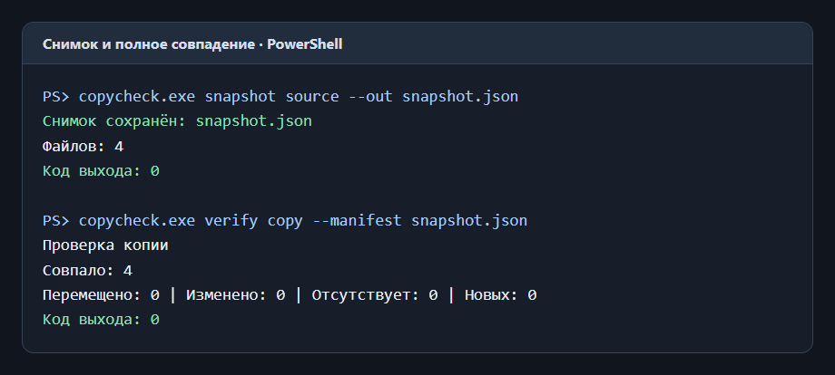
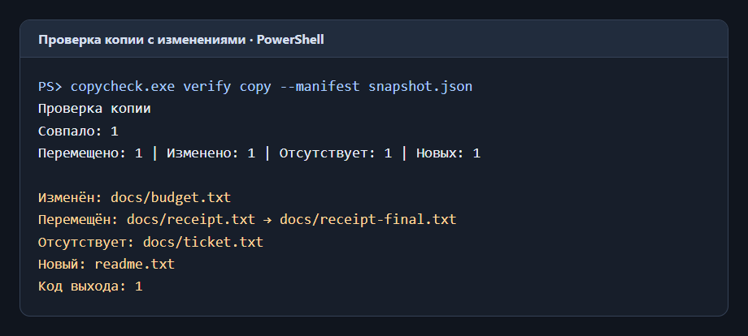

# CopyCheck

**Проверка копии папки после переноса файлов.** CopyCheck сохраняет SHA‑256 каждого файла до копирования и проверяет, что оказалось на другом диске. Манифест можно взять с собой и проверить копию уже после отключения исходной флешки.

[Скачать CopyCheck для Windows x64](https://github.com/Kriffi/copycheck/releases/latest/download/copycheck.exe) · [Релизы и контрольная сумма](https://github.com/Kriffi/copycheck/releases/latest)

## Как это выглядит

CopyCheck выводит обычный текст в консоль Windows. Ниже текст из двух запусков демо в PowerShell.

**Снимок и проверка точной копии**

```text
PS> copycheck.exe snapshot source --out snapshot.json
Снимок сохранён: snapshot.json
Файлов: 4
Код выхода: 0

PS> copycheck.exe verify copy --manifest snapshot.json
Проверка копии
Совпало: 4
Перемещено: 0 | Изменено: 0 | Отсутствует: 0 | Новых: 0
Код выхода: 0
```

**Проверка после изменения копии**

```text
PS> copycheck.exe verify copy --manifest snapshot.json
Проверка копии
Совпало: 1
Перемещено: 1 | Изменено: 1 | Отсутствует: 1 | Новых: 1

Изменён: docs/budget.txt
Перемещён: docs/receipt.txt → docs/receipt-final.txt
Отсутствует: docs/ticket.txt
Новый: readme.txt
Код выхода: 1
```

<details>
<summary>Оформленные изображения того же вывода</summary>

Цвета и рамка добавлены при оформлении README.





</details>

## Две команды

Скачай `copycheck.exe` и открой PowerShell в папке, куда он скачался. Создай снимок **до** копирования через Проводник.

```powershell
.\copycheck.exe snapshot "E:\Фото" --out photos.json
```

После копирования укажи папку, в которой сохранились те же вложенные папки и файлы.

```powershell
.\copycheck.exe verify "D:\Архив\Фото" --manifest photos.json
```

Программа читает файлы и создаёт только указанный манифест. Для `snapshot` выбери новое имя манифеста. Проверяй папку, содержимое которой в этот момент стабильно.

| Результат | Что обнаружила проверка |
| --- | --- |
| Совпало | Путь и содержимое совпадают. |
| Перемещён | Содержимое совпадает, а относительный путь изменился. |
| Изменён | Путь совпадает, содержимое отличается. |
| Отсутствует | В копии нет соответствующего файла. |
| Новый | Файл есть только в проверяемой папке. |

Код выхода `0` означает успешный снимок или полное совпадение, `1` — различия, `2` — ошибка. Ошибки чтения выводятся в `stderr`. При неполном чтении папки проверка останавливается с кодом `2`, поскольку отчёт о пропущенных файлах в таком случае был бы ненадёжным.

## Как устроено

1. **Сканирование.** До четырёх обработчиков читают обычные файлы порциями и вычисляют SHA‑256. В JSON сохраняются относительный путь, размер и хеш. Символические ссылки, пустые папки и метаданные файлов за пределами этого сравнения.
2. **Сопоставление.** Сначала сравниваются одноимённые относительные пути. Затем оставшиеся экземпляры связываются по размеру и хешу. Каждый файл копии участвует в сопоставлении один раз. Поэтому два одинаковых файла в исходнике и один в копии дают один найденный и один пропущенный, даже если сохранившийся файл переименовали.
3. **Детерминированный отчёт.** Пути отсортированы, поэтому при нескольких одинаковых кандидатах утилита выбирает их в порядке путей. Само совпадение содержимого подтверждается хешем, а первоначальное имя среди одинаковых копий по хешу определить невозможно.

Время проверки зависит от диска и общего объёма файлов. В памяти хранятся записи манифеста и индексы для сравнения. Содержимое большого файла читается порциями.

## Сборка и тесты

Требуется Go 1.22 или новее. Утилита использует стандартную библиотеку Go.

```powershell
git clone https://github.com/Kriffi/copycheck.git
cd copycheck
go test -v ./...
go vet ./...
go build -trimpath -o .\dist\copycheck.exe .
.\scripts\demo.ps1
```

Демо создаёт файлы во временной папке, проверяет точную копию, вносит четыре вида изменений и проверяет коды выхода. Тесты используют настоящие временные каталоги и покрывают дубликаты, кириллицу в путях, пустой файл, неверный JSON, проверку без исходной папки и защиту от перезаписи при снимке.
