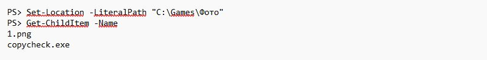
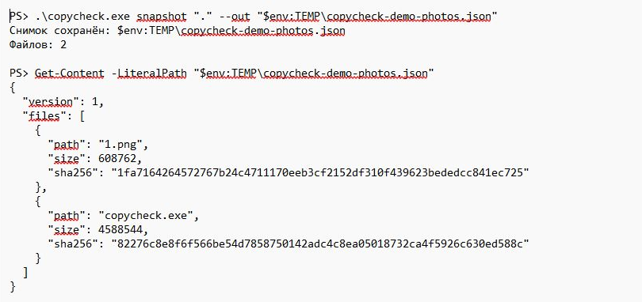
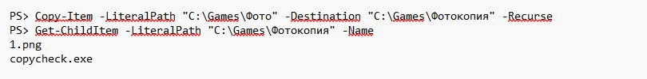
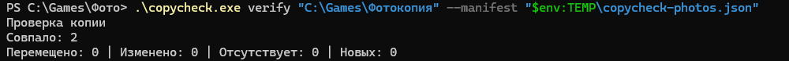

# CopyCheck — проверка копии после переноса файлов

Создай снимок исходной папки перед переносом. После копирования CopyCheck сравнит файлы по SHA-256 и покажет, какие пропали, изменились, переместились или появились. Сохрани JSON-снимок отдельно, чтобы проверить копию даже после отключения исходного диска.

[Скачать CopyCheck для Windows x64](https://github.com/Kriffi/copycheck/releases/latest/download/copycheck.exe) · [Релизы и контрольная сумма](https://github.com/Kriffi/copycheck/releases/latest)

## Когда пригодится

| Ситуация | Что покажет CopyCheck | Практическая выгода |
| --- | --- | --- |
| **Копирование архива прервалось.** При переносе 300 ГБ на внешний диск кабель отсоединился. После повторного подключения непонятно, что успело записаться целиком. | Отметит файлы, которых нет в копии, и файлы с отличающимся содержимым. Пока исходник доступен, можно докопировать только их. | Если повторной передачи требуют 2 ГБ, через кабель пройдёт на **298 ГБ меньше**, чем при повторном копировании всего архива. CopyCheck отдельно читает копию целиком для проверки. |
| **Фотографии разложили по другим папкам.** После переноса фото переименовали и распределили по годам. По именам уже трудно отличить переименованный файл от потерянного. | Найдёт совпадения по содержимому и покажет старый и новый путь. Файлы, для которых совпадения нет, попадут в отчёт как отсутствующие. | При ручной сверке 2 000 фото по 3 секунды на файл уйдёт **около 1 ч 40 мин**. Отчёт сразу показывает, куда переместились файлы и каких не хватает. |
| **Одноимённый отчёт затёрли старой версией.** После переноса папку объединили с архивом. Имя файла осталось прежним, а внутри оказались данные за другой месяц. | Отметит файл как изменённый, даже если имя и размер остались прежними. По отчёту можно найти нужный путь и восстановить правильную версию из исходника. | Если вручную открывать 60 отчётов по 30 секунд на каждый, поиск займёт **около 30 минут**. С отчётом достаточно открыть файлы, для которых найдено различие. |

Цифры в примерах показывают объём повторного копирования и ручной сверки. Длительность самой проверки зависит от количества файлов, их объёма и скорости диска.

## Проверка на Windows

Один пример от начала до конца. Исходная папка `C:\Games\Фото` содержит `1.png` и `copycheck.exe`. Оба файла попадают в проверку. Первые три изображения показывают команды и вывод запуска, открытые в Блокноте. Последнее снято в PowerShell при проверке тех же папок с первым снимком.

### 1. Открыть исходную папку

```powershell
Set-Location -LiteralPath "C:\Games\Фото"
Get-ChildItem -Name
```



### 2. Сохранить снимок до копирования

```powershell
.\copycheck.exe snapshot "." --out "$env:TEMP\copycheck-demo-photos.json"
Get-Content -LiteralPath "$env:TEMP\copycheck-demo-photos.json"
```

В JSON лежат относительный путь, размер и SHA-256 каждого файла. Выбери свободное имя для снимка, если этот файл уже есть.



### 3. Скопировать папку

```powershell
Copy-Item -LiteralPath "C:\Games\Фото" -Destination "C:\Games\Фотокопия" -Recurse
Get-ChildItem -LiteralPath "C:\Games\Фотокопия" -Name
```

Команда создаёт папку `Фотокопия` с нуля. При повторе используй свободный путь назначения.



### 4. Проверить копию

```powershell
.\copycheck.exe verify "C:\Games\Фотокопия" --manifest "$env:TEMP\copycheck-demo-photos.json"
```

В свежем запуске совпали оба файла, код выхода — `0`. На снимке PowerShell видно такой же результат для `copycheck-photos.json`, снимка тех же файлов из первого запуска.



Если переименовать `1.png` в `2.png` только в копии и снова выполнить проверку, CopyCheck находит файл по содержимому. Код выхода — `1`.

```text
Проверка копии
Совпало: 1
Перемещено: 1 | Изменено: 0 | Отсутствует: 0 | Новых: 0

Перемещён: 1.png → 2.png
```

## Две команды

Скачай `copycheck.exe` и открой PowerShell в папке, куда он скачался. Создай снимок **до** копирования через Проводник.

```powershell
.\copycheck.exe snapshot "E:\Фото" --out photos.json
```

После копирования укажи папку, в которой сохранились те же вложенные папки и файлы.

```powershell
.\copycheck.exe verify "D:\Архив\Фото" --manifest photos.json
```

Программа читает файлы и создаёт только указанный манифест. Для `snapshot` выбери новое имя манифеста. Проверяй папку, содержимое которой в этот момент стабильно.

| Результат | Что обнаружила проверка |
| --- | --- |
| Совпало | Путь и содержимое совпадают. |
| Перемещён | Содержимое совпадает, а относительный путь изменился. |
| Изменён | Путь совпадает, содержимое отличается. |
| Отсутствует | В копии нет соответствующего файла. |
| Новый | Файл есть только в проверяемой папке. |

Код выхода `0` означает успешный снимок или полное совпадение, `1` — различия, `2` — ошибка. Ошибки чтения выводятся в `stderr`. При неполном чтении папки проверка останавливается с кодом `2`, поскольку отчёт о пропущенных файлах в таком случае был бы ненадёжным.

## Как устроено

1. **Сканирование.** До четырёх обработчиков читают обычные файлы порциями и вычисляют SHA‑256. В JSON сохраняются относительный путь, размер и хеш. Символические ссылки, пустые папки и метаданные файлов за пределами этого сравнения.
2. **Сопоставление.** Сначала сравниваются одноимённые относительные пути. Затем оставшиеся экземпляры связываются по размеру и хешу. Каждый файл копии участвует в сопоставлении один раз. Поэтому два одинаковых файла в исходнике и один в копии дают один найденный и один пропущенный, даже если сохранившийся файл переименовали.
3. **Детерминированный отчёт.** Пути отсортированы, поэтому при нескольких одинаковых кандидатах утилита выбирает их в порядке путей. Само совпадение содержимого подтверждается хешем, а первоначальное имя среди одинаковых копий по хешу определить невозможно.

Время проверки зависит от диска и общего объёма файлов. В памяти хранятся записи манифеста и индексы для сравнения. Содержимое большого файла читается порциями.

## Сборка и тесты

Требуется Go 1.22 или новее. Утилита использует стандартную библиотеку Go.

```powershell
git clone https://github.com/Kriffi/copycheck.git
cd copycheck
go test -v ./...
go vet ./...
go build -trimpath -o .\dist\copycheck.exe .
.\scripts\demo.ps1
```

Демо создаёт файлы во временной папке, проверяет точную копию, вносит четыре вида изменений и проверяет коды выхода. Тесты используют настоящие временные каталоги и покрывают дубликаты, кириллицу в путях, пустой файл, неверный JSON, проверку без исходной папки и защиту от перезаписи при снимке.
